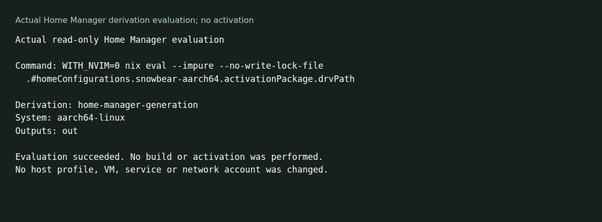

# Personal Nix configuration

Host and user configuration for nix-darwin on macOS, Home Manager on Linux and persistent Ubuntu VMs managed with Multipass. These files are tailored to the declared user and hosts; they are not a general NixOS installer.



The [local check](docs/demo/README.md) evaluated the Linux ARM64 Home Manager activation derivation. It did not build or activate it, change a profile or create a VM.

## Inspect before applying

With Nix installed and flakes enabled:

```sh
git clone https://github.com/olegpustovit/nixos-config.git
cd nixos-config
WITH_NVIM=0 nix eval --impure --no-write-lock-file .#homeConfigurations.snowbear-aarch64.activationPackage.drvPath
make help
```

The exact evaluation passed with Nix 2.34.7 on Linux ARM64. It can download locked inputs. The managed user is `snowbear`; adapt the user and host definitions before using this as your own configuration.

## Apply an intended configuration

`make build` builds the host configuration. `make switch` applies it. On macOS those target nix-darwin; on Linux they target Home Manager. Read [Makefile](Makefile) for user, architecture and privilege handling before running either. Plain `make` defaults to switch.

`WITH_NVIM=1` opts into the managed Neovim configuration. It is off by default, so a user-owned editor checkout can remain separate. Inspect the pinned editor/plugin inputs and their integration gates before enabling it; this capture did not evaluate that mode.

## Outputs and layout

The flake declares `darwinConfigurations.mac`, `homeConfigurations.snowbear-x86_64`, `homeConfigurations.snowbear-aarch64` and the ARM64 Linux Home Manager package/app outputs. Modules live under [darwin](darwin/) and [home](home/); output builders live under [nix](nix/).

[Multipass instructions](docs/multipass.md) describe the persistent-VM workflow. Bootstrap preserves an existing VM; reset deletes and recreates it. No Multipass, Tailscale login, macOS rebuild, package closure build or host activation was tested for the evaluation capture.

[Agent guidance](AGENTS.md) · [MIT license](LICENSE)
